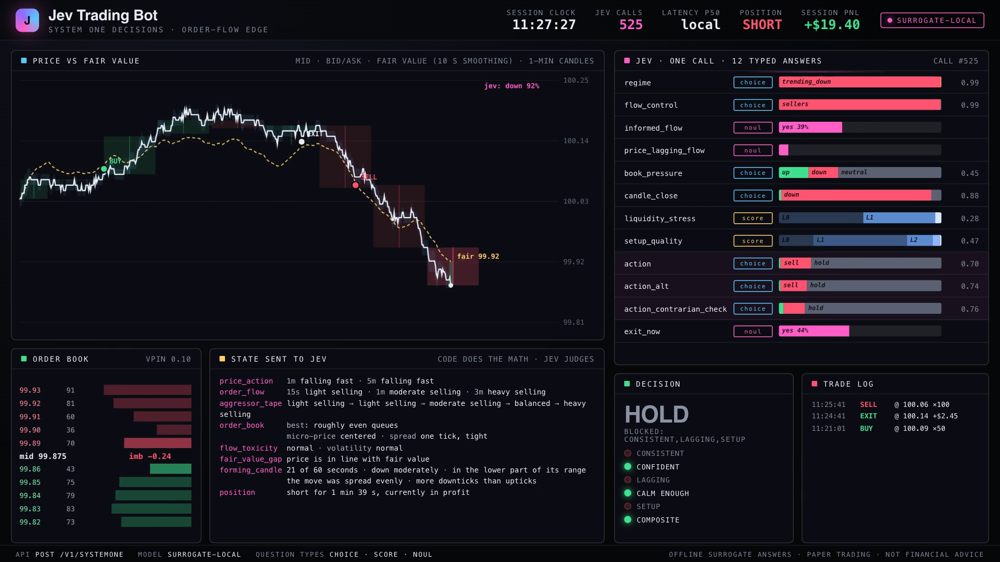

# Jev Trading Bot

An order-flow trading bot whose decisions are made by **Jev**, TypeSafe's
*System One* model: a model that doesn't write text, but returns typed,
calibrated answers (a choice, a score, a yes/no probability) in ~100 ms.

The split follows Jev's own documentation. **Code does the math, and Jev
does the judgment.** A quant engine reads the limit order book second by
second and measures what the market is doing (order-flow imbalance,
micro-price, VPIN, a fair-value model, the shape of the forming candle). The
bot turns those numbers into a plain-language market state, asks Jev 12 atomic
questions about it in one parallel call, and only trades when the answers are
confident, agree with each other, and agree with the flow.



*The replay dashboard: price against the fair value, the book, every typed
answer from every Jev call, the decision gates and the exact state Jev was
sent. `jev-bot demo` writes it as one self-contained HTML file.*

---

## What it does

```
limit order book (1 s snapshots) + signed trade volume
        │
        ▼
quant engine                    order-flow imbalance (Cont, Kukanov & Stoikov 2014)
  jev_bot/features.py           micro-price, queue and depth imbalance
  jev_bot/quant.py              VPIN (Easley, López de Prado & O'Hara 2012), Kyle's λ
                                fair value: online RLS on all of the above, walk-forward
                                shape of the forming candle (incl. Lévy area of the path)
        │
        ▼
state builder                   numbers → named buckets Jev reads well
  jev_bot/state.py              "heavy buying", "bid queue much thicker than the ask",
                                "price is below where the order flow says it should be"
        │
        ▼
Jev  POST /v1/systemone         12 typed questions, one call, evaluated in parallel
  jev_bot/questions.py          regime · flow_control · informed_flow · price_lagging_flow
  jev_bot/typesafe.py           book_pressure · candle_close · liquidity_stress · setup_quality
                                action ×3 (self-consistency) · exit_now (speculative)
        │
        ▼
decision                        composite score (weights in code)
  jev_bot/decide.py             confidence-gated sizing: full / half / none
                                all three action answers must agree
        │
        ▼
execution + grading             fill 1 s later at the far side of the book, plus fees
  jev_bot/engine.py             vs 1,000 random traders with the same trade count and hold times
```

### Every Jev feature, and where it's used

| Jev / TypeSafe feature | Where |
|---|---|
| **Choice** (options + probabilities + confidence) | `regime`, `flow_control`, `book_pressure`, `candle_close`, three `action` questions |
| **Score** (probability-weighted level + confidence) | `liquidity_stress` (3 levels), `setup_quality` (5 levels) |
| **Noul** (yes/no probability, with `true`/`false` criteria) | `informed_flow`, `price_lagging_flow`, `exit_now` |
| **Parallel questions in one call** | all 12 per decision tick; latency barely moves with question count |
| **Speculative fan-out** | `exit_now` is asked even when flat and only read when a position is open |
| **Structured instructions** (object + backtick field references) | `price_lagging_flow`, `action_alt`, every question points at a named state field |
| **Structured JSON state** | `state.py` builds nested JSON with only the fields the questions need |
| **Confidence-gated routing** | `decide.py`: < 0.35 no trade, 0.35–0.65 half size, ≥ 0.65 full size |
| **Composite scoring** | `decide.composite_score`: weighted sum of atomic answers, weights in code |
| **Self-consistency** | the action is asked three ways; all three must agree |
| **Model aliases / pinning** | `--model jev-latest` or pin `--model jev-1.13.0`; the answering version is logged |
| **`GET /v1/models`** | `jev-bot models` |
| **Usage and cost** | input tokens × $0.042/Mtok tracked per run, p50 latency reported |
| **Retries on 429 / 529** | exponential backoff honouring `retry-after` |
| **Replayable runs** | `--cache run.jsonl` records every call; `--replay-cache` replays with no key |

And the Jev 1.13 [jaggedness notes](https://docs.typesafe.ai/model-jaggedness/jev-1.13) are
designed in: no arithmetic or counting is asked of the model, numbers arrive
as named buckets, each question is literal and single-hop, and the state
carries only what the questions need.

---

## Quick start

```bash
git clone <this repo> && cd jev-trading-bot
python -m venv .venv && source .venv/bin/activate
pip install -e ".[dev]"

jev-bot demo                     # simulate a 6 h session, trade it, write runs/demo/
open runs/demo/replay.html       # the animated replay
```

Without a key the bot uses an **offline surrogate** (`jev_bot/surrogate.py`),
a small rule model that answers the same questions with the same typed
shapes so everything runs, tests and renders. It is *not* Jev.

With Jev:

```bash
export TYPESAFE_API_KEY=...      # https://console.typesafe.ai/keys
jev-bot models                   # which models your key can use
jev-bot ask examples/state.json  # one call, all 12 typed answers
jev-bot --model jev-latest --cache runs/jev.jsonl demo
jev-bot --replay-cache runs/jev.jsonl --model jev-latest demo   # replay it, no key needed
jev-bot --model jev-latest paper --minutes 30 -v                # real-time paper loop
```

Live XAUUSD through a MetaTrader 5 terminal is a separate command and stays
in dry-run until you opt in. Setup, the cent-account limits and the book
signals that go quiet without depth are in [Live trading](#live-trading-metatrader-5).

```bash
jev-bot live --broker mt5 --dry-run
```

### Which model decides

With `TYPESAFE_API_KEY` set, live calls the same client as `jev-bot models` and `jev-bot ask`: `POST /v1/systemone`, model `jev-latest` unless you pin one with `--model jev-1.13.0`. The startup line names it, for example `model jev-latest (TypeSafe Jev)`. The first answer also logs the version the API actually used. The key is read only from the environment. It is not written to the repo, the log, or an error message.

Without the key, live keeps running on the offline surrogate and prints a warning that these are not Jev's decisions. `--model surrogate` forces that stand-in even when a key is present.

The client times out, retries with backoff, and honours `retry-after` on HTTP 429 and 529. If the API is still down after those retries, that bar is a hold: nothing is sent and the process stays up. Confidence gates, the three agreeing action answers, the lot and loss limits, and the dry-run default are unchanged.

RoboForex does not publish XAUUSD depth. The state Jev receives then has `data_quality.book_signals` set to `degraded`, and the book-pressure question is told that `best_level`, `top_five_levels` and `micro_price` are placeholders. Trade flow, spread, volatility, the candle and fair value are still filled from the quote and the signed tick volume.

A 6-hour session at one call every 10 s is 1,980 calls. The request (state
plus 12 questions) is about 5.2k characters, roughly 1,300 input tokens, so a
session is ~2.6 M tokens, **about $0.11** at the published $0.042 per million.
Output is free. The exact count is in the report (`API usage`).

Your own data: `jev-bot backtest --csv your.csv`. The CSV needs
`t, bid, ask, bid_sz0, ask_sz0` and either `buy_vol, sell_vol` (aggressor-signed)
or `volume` (split with bulk volume classification). Extra depth columns
`bid_sz1.. / ask_sz1..` are used when present. `jev-bot simulate out.csv`
writes an example.

---

## Results on the simulator (surrogate model)

`jev-bot demo`, 6 h at 1 s resolution, a decision every 10 s, 100 units per
full position, fees on both sides:

| seed | trades | net PnL | hit rate | beats random traders | flags → 2σ move | median flag lead |
|---|---|---|---|---|---|---|
| 1 | 55 | $484 | 53% | 100% | 9 / 25 | 206 s |
| 2 | 74 | $206 | 41% | 100% | 5 / 24 | 115 s |
| 3 | 59 | $461 | 49% | 100% | 12 / 30 | 260 s |
| 4 | 28 | $97 | 57% | 100% | 3 / 9 | 75 s |
| 5 | 46 | $346 | 57% | 100% | 7 / 18 | 164 s |

Reading the forming candle 20–50 s into the bar, the surrogate's
`candle_close` was right 84–91% of the times it committed (about 70% of
ticks), against 76–84% for "the candle keeps its current colour".

**Read these numbers for what they are.** The simulator (`jev_bot/sim.py`)
is an agent model *built to contain* the effect the bot hunts: informed
traders know a hidden fair value, and the market maker absorbs their flow with
a lag. The results show that the pipeline finds a real order-flow edge when
one exists, fills honestly and doesn't look ahead (there are tests for that).
They say nothing about any real market, and they were produced by the
surrogate, not by Jev. Run it against Jev and your own data before believing
anything.

---

## Live trading (MetaTrader 5)

`jev-bot live` runs the same feature, state and decision path as `paper`.
The one-second book comes from a logged-in MetaTrader 5 terminal instead of
`sim.py`, and an order that passes the risk checks is either logged or sent
with `order_send`. The official `MetaTrader5` package only imports on the
Windows machine where the terminal is installed. Linux and the test suite use
a fake terminal, so nothing here talks to a broker during tests.

```bash
pip install -e ".[mt5]"          # on that Windows machine, next to the terminal
jev-bot live --broker mt5 --dry-run
```

### Terminal setup

1. Install MetaTrader 5 and open a **RoboForex demo** account in the terminal.
2. Turn on **Algo Trading** (Tools → Options → Expert Advisors, and the AutoTrading button in the toolbar).
3. Show the gold symbol in Market Watch. The name is often `XAUUSD`, and on RoboForex it is often `XAUUSDc`, `XAUUSD.c` or `XAUUSDm`. `--symbol XAUUSD` uses the exact name when the terminal has it, and otherwise tries those suffixes.
4. Leave the terminal logged in. Login, password and server are read from `MT5_LOGIN`, `MT5_PASSWORD` and `MT5_SERVER` only when you want the process to attach by itself. They are never written into the repo or into the log. `TYPESAFE_API_KEY` stays in the environment as well. With the three `MT5_*` variables unset, the bot attaches to the terminal that is already logged in.

### What is sent

Dry-run is the default, including when you pass `--dry-run` explicitly. Orders are printed and the terminal's `order_send` is not called.

```bash
jev-bot live --broker mt5 --dry-run          # log only; spread 30, stop 200, target 400, hold 900s
jev-bot live --broker mt5 --send             # demo or contest account
jev-bot live --broker mt5 --dry-run --avoid-hours 13:00-17:00
```

A real-money account, **including a cent account**, needs both the flag and the confirmation phrase:

```bash
export MT5_CONFIRM_REAL=YES_TRADE_REAL
jev-bot live --broker mt5 --send --allow-real
```

Full size defaults to `0.01` lot, the usual minimum on a cent account. Half size is half of `--lot` and is skipped when that is below the broker's volume step (use `--lot 0.02` when the minimum is `0.01` and you want the half-size rung). Volume is snapped down to the step, entries wider than `--max-spread` (points, default 30) are skipped, and the filling mode follows the symbol: market and exchange execution use `RETURN`, instant execution uses `FOK` or `IOC` as the symbol allows. `--deviation` (default 15) is the slippage in points. Buys pay the ask, sells hit the bid.

`--sl-points` and `--tp-points` default to 200 and 400. `0` still leaves that side unset. The distance is widened to the broker's minimum stop level when it is closer, and the price is rounded to the symbol's digits. Live orders send those prices as the position's stop loss and take profit, and the log names `stop loss` or `take profit` when the terminal reports the position closed. Dry-run watches the same prices without sending: a long exits on the bid, a short on the ask, at that rounded price. A quote that crosses both levels takes the stop.

`--max-hold-seconds` defaults to 900. When an open position has been held that long it is closed, in dry-run and live, and the log says `max hold 900s`. The process keeps running. `0` disables the limit.

`--avoid-hours` is off unless you set it. `13:00-17:00` blocks new entries from 13:00 inclusive to 17:00 exclusive in Europe/Berlin, which is the London and New York overlap in local time, including daylight saving. A window that passes midnight (`22:00-02:00`) wraps. Positions already open are left alone: Jev can still exit them, and the stop, the hold limit, the daily loss and the kill file still apply. The startup lines print every effective value, including a control that is off.

### Limits

| control | default | effect |
|---|---|---|
| `--max-lots` | `0.05` | one order, and the resulting position, cannot be larger |
| `--max-positions` | `1` | no new entry at the cap; closes are still sent |
| `--max-daily-loss` | `20` | account currency (cents on a cent account), from 00:00 UTC. At the line, everything this bot opened is closed and the process stops |
| `--max-spread` | `30` | skip a new entry when the spread is wider, in points |
| `--sl-points` | `200` | broker stop, and the same exit in dry-run. `0` leaves it unset |
| `--tp-points` | `400` | broker take-profit, and the same exit in dry-run. `0` leaves it unset |
| `--deviation` | `15` | slippage allowance in points |
| `--max-hold-seconds` | `900` | close the open position after this many seconds. `0` disables it. The session stays up |
| `--avoid-hours` | off | `HH:MM-HH:MM` in Europe/Berlin. Blocks new entries only. `13:00-17:00` skips the London/New York overlap |
| `--hours gold` | on | XAUUSD session on the America/New_York clock, with a few minutes of buffer around the daily break. If that time zone cannot be loaded the session stops before it connects. Windows gets the database from the `tzdata` dependency. `--hours always` disables the filter. `--avoid-hours` needs Europe/Berlin the same way, and only when the option is set |
| `jev.KILL` | `--kill-file` | creating this file closes the bot's positions and stops the process. Ctrl-C does the same |
| a dead terminal, or ~30 s without a tick while the session is open | | close, then stop |
| Jev API errors | | hold that bar. No order, and the process stays up |

Closes use the bot's magic number (`--magic`, default `20261027`) on the configured symbol. Other positions on the account are left alone. A symbol the terminal marks close-only or disabled is not opened.

### Depth, and the signals that go quiet

Each second is one row: last bid, last ask, and tick volume signed by the MT5 tick flags (then by the last price, then by the tick rule). When `market_book_get` returns both a bid and an ask, those levels fill the book, up to five. Otherwise the second is a **level-1 fallback** with the same placeholder size on both sides, so the math in `features.py` stays defined.

These signals are degraded on that fallback. The state field Jev reads is in parentheses:

- queue imbalance (`order_book.best_level`) — the two queues are equal, so the imbalance is zero
- depth imbalance (`order_book.top_five_levels`) — one level copies the best level
- micro-price (`order_book.micro_price`) — equal queues put the weighted mid on the mid
- order-flow imbalance magnitude — the size terms are 1; the sign of a quote change remains

These keep using bid, ask and the signed tick volume: aggressor trade imbalance, VPIN, Kyle's λ, spread, realised volatility, momentum, the forming candle, and the fair-value model. The fair-value fit still runs; its book inputs are flat while the placeholder book sits in the window, so that part of the fit is idle. History loaded from the terminal has no depth either. The first decisions wait until `--warmup` seconds are in the window (1800 by default, and at least 300, which is the momentum window in `features.py`). A quiet second still records the current bid and ask with zero volume. `copy_ticks_range` fills the warmup when the terminal has the ticks.

MT5 tick times are the broker server clock, not UTC. RoboForex is often two or three hours ahead. The session measures that offset from the latest quote against the computer clock, shifts every bar to UTC, and asks the terminal for history in the broker clock. The gold session and the daily-loss window stay on real UTC (New York, and 00:00 UTC). A quiet second cannot restart the warmup.

Gold spreads and commissions are wide relative to the move this bot is built to catch. They can consume the edge entirely. The table in the previous section is the simulator, with the surrogate, on a book that was built to contain the effect. It is not a live result and it is not a forecast for XAUUSD.

---

## Layout

```
jev_bot/
  typesafe.py    Jev client: Noul / Choice / Score, answers, retries, cost, cache, /v1/models
  questions.py   the 12 questions
  state.py       numbers → semantic, structured state
  surrogate.py   offline stand-in with the same typed interface
  decide.py      composite score, confidence gates, self-consistency
  features.py    OFI, micro-price, imbalances, VPIN, Kyle's λ, candle shape
  quant.py       walk-forward fair-value model (RLS) and candle model (online logistic)
  signals.py     divergence flags
  engine.py      the session loop, fills, grading
  sim.py         synthetic order book with a hidden fair value
  replay.py      builds the animated HTML dashboard (assets/dashboard.html)
  live.py        live session: the same features, state and decision, on a broker feed
  mt5_feed.py    one-second bars, tick-flag aggressor, level-1 fallback
  mt5_broker.py  MetaTrader 5 terminal: symbols, quotes, depth, order_send
  risk.py        dry-run, account gate, lot/spread/loss limits, session hours, kill file
  cli.py         jev-bot demo | backtest | paper | live | ask | models | simulate
tests/           the original 20 (math, causality, client, gates, end to end) plus the MT5 adapter and risk limits
docs/MATH.md     the formulas and the papers they come from
```

```bash
python -m pytest          # or: python -m unittest
```

---

## Disclaimer

Research and education code. The default live command logs orders and sends
nothing. A demo account can place orders with `--send`. A real-money or cent
account also needs `--allow-real` and `MT5_CONFIRM_REAL`. Gold spreads and
fees can erase the edge the simulator reports, and those simulator numbers
are not a live result. Nothing in this repository is financial advice. Jev
and TypeSafe are products of TypeSafe AI; this project is not affiliated
with them or with RoboForex.
